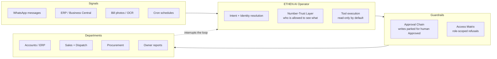

# ETHEN Ops — The AI Operator System That Runs a Real Factory

   

> **Not a demo. A deployed AI operations system running inside a real Nepali manufacturing company — ERP automation, a WhatsApp AI support desk, OCR bill auditing, and daily ops dashboards. One system. Zero new hires.**

This repo is the public portfolio of **ETHEN Ops** — the agency that installs the same system in other businesses. Everything here is proof-first: real architecture, real portfolio pages, open templates, and public pricing.

---

## 🏭 The Proof

Inside a Nepali manufacturing company, ETHEN:

- **Answers staff questions 24/7 on WhatsApp** — stock, prices, ledgers, order status — pulled live from the ERP
- **Audits supplier bills with OCR** — photograph a bill → structured data → ledger. No typing.
- **Reports to the boss every morning** — sales, stock, and cash numbers as a WhatsApp message before work starts
- **Refuses what it isn't allowed to do** — every write action passes a human approval chain; access is matrix-scoped per person

### Architecture — "The Operator Loop"

**The loop:** signals in → identity + trust check → tool execution (read-only by default) → approval chain for any write → departments served → exceptions interrupt the loop and escalate to a human.

---

## 🛠️ Services

| Service | What it is | Timeline |
|---|---|---|
| **WhatsApp AI Desk** | Your staff/customers ask on WhatsApp; the AI answers from your live data (ERP, price lists, order status) | Live in 7 days |
| **OCR Pipeline** | Photograph any bill/invoice → clean structured data in your ledger | Live in 7–14 days |
| **Ops Dashboards** | Morning reports, wall dashboards, sales/stock/cash visibility for the owner | Live in 7 days |

Full offers and pricing → [`/offers`](./offers)

---

## 📁 What's in this repo

- **[`/assets`](./assets)** — portfolio pages (open `agency.html`, `whatsapp-demo.html`, `ops-team.html` directly in a browser, or via GitHub Pages below)
- **[`/offers`](./offers)** — the 3 installation offers + public pricing
- **[`/templates`](./templates)** — free open-source lead magnets: an approval-popup UI pattern and an OCR demo guide. **Star ⭐ / fork 🍴 them.**

---

## 💬 Contact

- **WhatsApp:** `wa.me/YOUR_NUMBER` *(placeholder — wire your number here)*
- **Email:** `hello@example.com` *(placeholder)*

Start with the **5-Day AI Ops Audit** — your 10 biggest time-leaks found, priced, and ranked. Credited toward any build.

---

## License

Code templates in `/templates` are MIT. Portfolio pages © ETHEN Ops.
